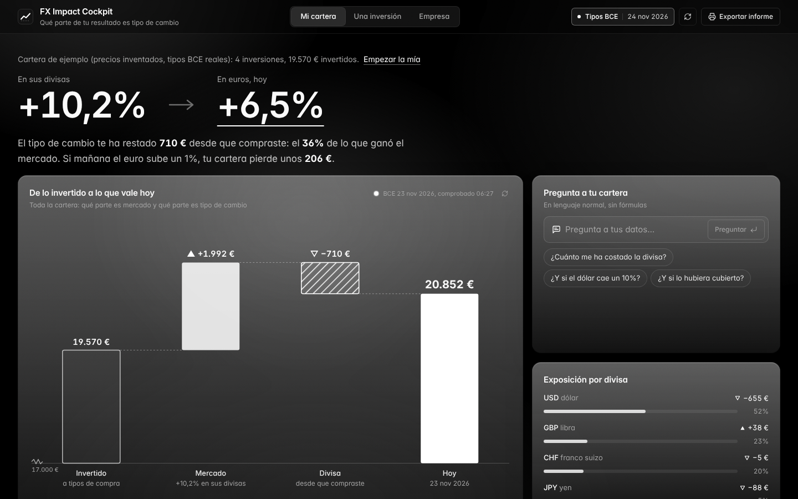
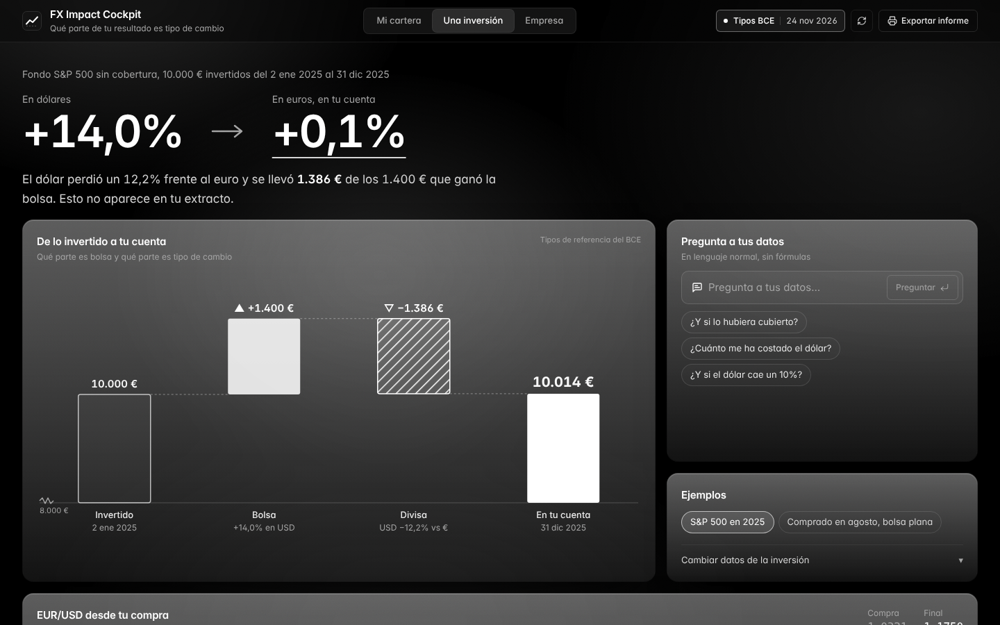
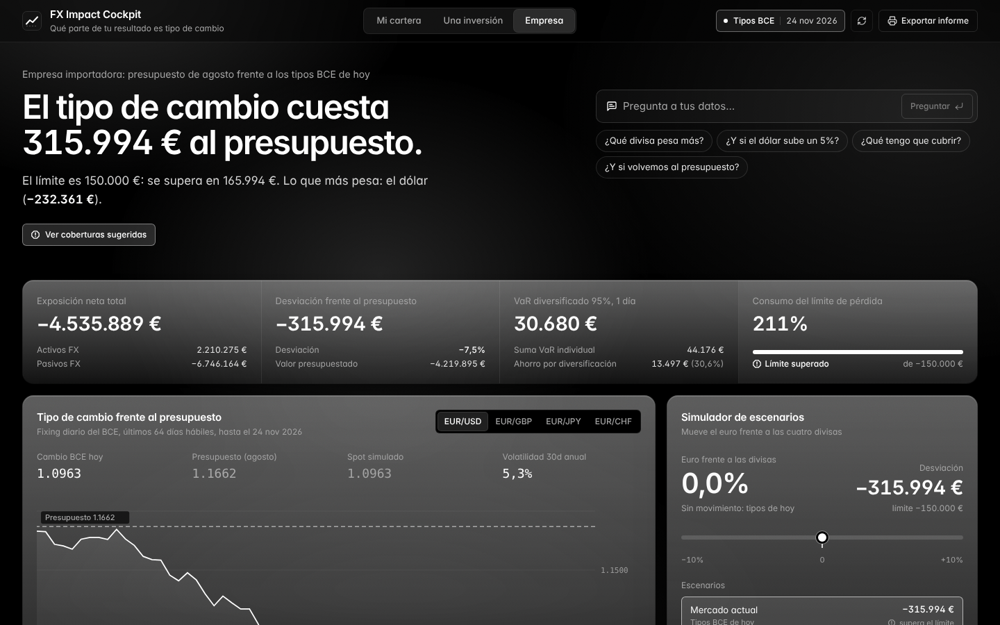

# FX Impact Cockpit

**Cuánto de tu resultado es tipo de cambio.**

En 2025 el S&P 500 subió cerca de un 14 % en dólares. Un inversor europeo que lo compró el 2 de enero y lo valoró el 31 de diciembre ganó un 0,1 % en euros: el dólar perdió un 12,2 % frente al euro y se llevó casi toda la ganancia. Eso no aparece en el extracto.

En las empresas pasa lo mismo, pero con millones: el tipo de cambio del presupuesto se fija una vez y nadie lo vuelve a mirar hasta el cierre.

Esta app separa, con los tipos oficiales del Banco Central Europeo, qué parte de un resultado es mercado y qué parte es divisa.



## Qué hace

**Mi cartera.** Añades lo que compraste: cantidad, precio y fecha de compra, y la divisa. La app trae el tipo del BCE de ese día (puedes cambiarlo por el que te aplicó tu bróker), consulta el tipo de hoy y lo vuelve a comprobar cada 15 minutos. Para cada inversión y para la cartera entera separa:

- **Mercado:** lo que ha cambiado el precio, a tu tipo de cambio de compra.
- **Divisa:** lo que ha cambiado el valor solo por el tipo de cambio.
- **Exposición por divisa** y cuánto perderías si mañana el euro sube un 1 %.

El precio actual de cada activo lo escribes tú: no hay una fuente gratuita de cotizaciones en tiempo real que funcione sin registro. Tus datos se guardan solo en tu navegador (`localStorage`). No hay servidor ni cuentas.

**Una inversión.** El caso del S&P 500 en 2025, o cualquier inversión desde el año 2000, con el puente de lo invertido a lo que vale en tu cuenta.

**Empresa.** Una importadora con pagos en dólares, yenes y francos y cobros en libras, frente a su forecast de agosto. Desviación, consumo del límite de pérdida, VaR al 95 %, simulador de escenarios y coberturas sugeridas.

**Preguntas en lenguaje normal.** "¿Y si el dólar cae un 10 %?", "¿Cuánto me ha costado la divisa?", "¿Y si lo hubiera cubierto?". Se interpretan con reglas, sin IA: responden al instante y sin conexión.

| Una inversión | Empresa |
| --- | --- |
|  |  |

## Datos

- Tipos de referencia del BCE a través de [Frankfurter](https://frankfurter.dev), sin clave. El BCE los publica cada día hábil hacia las 16:00 (hora de Madrid).
- Si no hay conexión, la app usa una copia semanal de los tipos de 2025-2026 incluida en el código y lo indica en pantalla.
- La cartera de ejemplo tiene precios inventados y tipos de compra reales del BCE.

## Cómo se calcula

Para una inversión de `q` unidades compradas a precio `P₀` con tipo `FX₀` (divisas por euro), valorada a precio `P₁` con tipo `FX₁`:

```
Invertido (EUR) = q · P₀ / FX₀
Valor hoy (EUR) = q · P₁ / FX₁
Mercado         = q · (P₁ − P₀) / FX₀
Divisa          = q · P₁ · (1/FX₁ − 1/FX₀)
Mercado + Divisa = Valor hoy − Invertido
```

## Ejecutarla en local

```bash
npm install
npm run dev      # http://localhost:5173
npm run build    # comprueba tipos y genera dist/
```

Stack: Vite, React, TypeScript, Tailwind CSS, Recharts, Lucide. Cada `push` a `main` se publica en GitHub Pages con la acción de `.github/workflows/deploy.yml`.

## Aviso

Herramienta educativa con ejemplos ilustrativos. No es asesoramiento financiero.

Licencia MIT.
